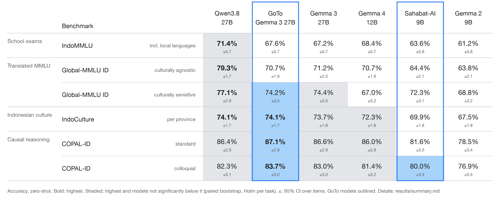
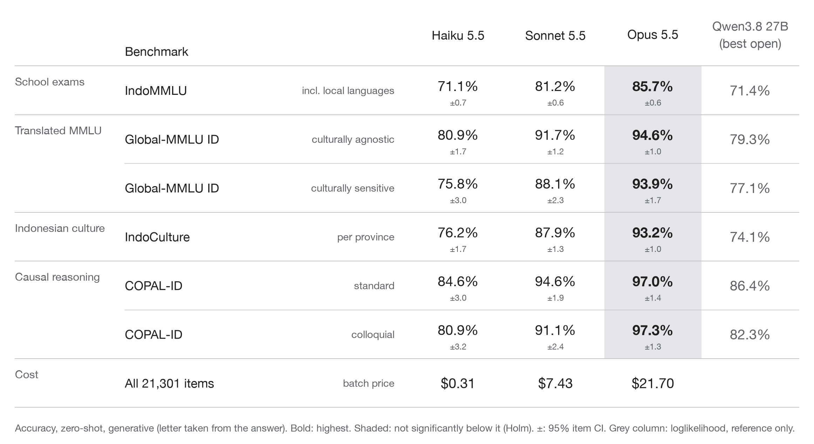

# indobench

An evaluation study of open-weight LLMs on four existing Indonesian benchmarks (IndoMMLU, IndoCulture, Global-MMLU ID, COPAL-ID), with Claude models as a closed reference. Phase 0 writes no test items of its own; an original dataset is planned for phase 1 (`spec-ifeval-id-gaul.md`).

**Summary.** A general model, Qwen3.8 27B, scores highest or ties for highest on all six task splits. GoTo's continued pretraining (CPT) of Gemma 3 27B shows no measurable gain over its base (every delta under 1 point). Sahabat-AI's CPT of Gemma 2 9B adds 2.3 to 3.5 points on four of six splits. On the tasks with subject or province labels, both conclusions hold when whole subjects or provinces are resampled instead of items. Every per-item prediction is in the repo, and `scripts/reproduce.sh` rebuilds every table from them in under half a minute on a laptop.

## 1. Research questions

1. **RQ1.** Do regional derivatives of older bases (GoTo Gemma 3 27B, GoTo Sahabat-AI on Gemma 2 9B) still match the newest general models (Qwen3.8, Gemma 4) in Indonesian?
2. **RQ2.** How much does regional CPT add over its own base, especially in colloquial Indonesian?

## 2. Method

### 2.1 Models

| Model | Hugging Face repo | Params | Role |
|---|---|---|---|
| Qwen3.8 27B | `Qwen/Qwen3.8-27B` | 27.8B | newest general |
| GoTo Gemma 3 27B | `GoToCompany/gemma3-27b-cpt-gotoai-v3-instruct` | 27.4B | regional CPT of Gemma 3 27B |
| Gemma 3 27B | `google/gemma-3-27b-it` | 27.4B | base of GoTo Gemma 3 |
| Gemma 4 12B | `google/gemma-4-12B-it` | 12.0B | newest general, smaller |
| Sahabat-AI 9B | `GoToCompany/gemma2-9b-cpt-sahabatai-v1-instruct` | 9.2B | regional CPT of Gemma 2 9B |
| Gemma 2 9B | `google/gemma-2-9b-it` | 9.2B | base of Sahabat-AI |
| Claude Haiku / Sonnet / Opus 5.5 | Anthropic API | n/a | closed reference |

Each open model is pinned to a commit SHA in `configs/models.yaml`. The GoTo Gemma 3 card does not declare its base; pairing it with Gemma 3 27B is our assumption.

### 2.2 Tasks

| Task | Items | Options | Random baseline | Cluster unit (count) |
|---|---|---|---|---|
| IndoMMLU (school exams, incl. local languages) | 14,904 | 3–5 | 23.5% | subject (25) |
| Global-MMLU ID, culturally agnostic | 2,058 | 4 | 25% | subject (55) |
| Global-MMLU ID, culturally sensitive | 792 | 4 | 25% | subject (45) |
| IndoCulture | 2,429 | 3 | 33.3% | province (11) |
| COPAL-ID standard / colloquial | 559 each | 2 | 50% | none |

Datasets load from their original Hugging Face repos (task names and subsets in `configs/tasks.yaml`; dataset revisions are not pinned). lm_eval's built-in `copal_id` task cuts the last character of 79% of colloquial premises, so we use a fixed lettered-MCQ version (`tasks/copal_id`, details in `NOTES_tasks.md`).

### 2.3 Scoring

- **Open models:** EleutherAI lm-evaluation-harness 0.4.13 with vLLM 0.32, BF16, zero-shot, chat template applied. Each item is a lettered multiple-choice question. The model's answer is the letter with the highest loglikelihood after a `Jawaban:` prefix in the assistant turn. Multimodal models load text-only; thinking-capable templates get `enable_thinking=False`.
- **Claude (reference only):** the same prompts over the Anthropic Message Batches API. The model writes an answer and a regex extracts the letter; an answer with no letter counts as wrong. Because scoring differs, Claude is not ranked against the open models.

### 2.4 Statistics

- **CIs:** percentile bootstrap over items, 10,000 resamples, seed 0.
- **Model differences:** paired bootstrap over the same items. "Best per task" compares every model with the top model and Holm-corrects within each task; a model not significantly below the top counts as tied. The two CPT-pair tests (RQ2) are reported uncorrected.
- **Robustness:** a cluster bootstrap resamples whole subjects (IndoMMLU, Global-MMLU) or provinces (IndoCulture) instead of items, for both the CIs and the paired tests.

## 3. Results (October 2026)

### 3.1 Open models

Accuracy (%), zero-shot. Bold is the highest score; shaded cells are the highest score and every model not significantly below it (paired bootstrap over items, Holm-corrected within each task). Full tables: [`results/summary.md`](results/summary.md). Write-up: [`blog/phase0-draft.md`](blog/phase0-draft.md).



<details>
<summary>Same table as text</summary>

| Task | n | Qwen3.8 27B | GoTo Gemma 3 27B | Gemma 3 27B | Gemma 4 12B | Sahabat-AI 9B | Gemma 2 9B |
|---|---|---|---|---|---|---|---|
| IndoMMLU | 14,904 | **71.4** | 67.6 | 67.2 | 68.4 | 63.6 | 61.2 |
| Global-MMLU ID, culturally agnostic | 2,058 | **79.3** | 70.7 | 71.2 | 70.7 | 64.4 | 63.8 |
| Global-MMLU ID, culturally sensitive | 792 | **77.1** | 74.2 ≈ | 74.4 ≈ | 67.0 | 72.3 | 68.8 |
| IndoCulture | 2,429 | **74.1** | **74.1** | 73.7 ≈ | 72.3 ≈ | 69.9 | 67.5 |
| COPAL-ID standard | 559 | 86.4 ≈ | **87.1** | 86.6 ≈ | 86.0 ≈ | 81.6 | 78.5 |
| COPAL-ID colloquial | 559 | 82.3 ≈ | **83.7** | 83.0 ≈ | 81.4 ≈ | 80.0 ≈ | 76.9 |

≈ = not significantly below the best model on that task.

</details>

- **Exams and translated MMLU:** Qwen3.8 is best and significantly above every other model on IndoMMLU (+3.0 over the next model) and Global-MMLU culturally agnostic (+8.1).
- **Global-MMLU "culturally sensitive" is not a test of Indonesian culture:** the Global-MMLU paper reports that most of these questions need Western cultural knowledge. Qwen3.8 leads; GoTo Gemma 3 and Gemma 3 are not significantly lower.
- **Indonesian culture (IndoCulture):** Qwen3.8 and GoTo Gemma 3 tie at 74.1; Gemma 3 and Gemma 4 12B are not significantly lower.
- **COPAL-ID:** the four strongest models are statistically tied. GoTo Gemma 3's top score is within noise, and base Gemma 3 scores the same, so this is not a CPT effect.
- **CPT over its own base (question 2):**
  - GoTo Gemma 3 27B vs Gemma 3 27B: no measurable gain. Every delta is under 1 point; only IndoMMLU (+0.4) is significant.
  - Sahabat-AI 9B vs Gemma 2 9B: +0.6 to +3.5 points. Significant (paired bootstrap, p < 0.05, uncorrected) on IndoMMLU (+2.4), IndoCulture (+2.3), Global-MMLU culturally sensitive (+3.5) and COPAL-ID standard (+3.0); not on Global-MMLU culturally agnostic (+0.6) or COPAL-ID colloquial (+3.0, p = 0.07).
- **Colloquial penalty on COPAL-ID:** 1.6 to 4.7 points. Significant for the four 27B/12B models, not for the two Gemma 2 9B models, whose standard-register scores are lower to begin with.

### 3.2 Robustness: clustered bootstrap

Resampling whole subjects or provinces instead of items:
- **Absolute scores are much less certain than the ± suggests.** For the open models the 95% CI widens 6.9 to 7.8 times on IndoMMLU (Qwen3.8: 65.1 to 76.0 instead of 70.7 to 72.1), 2.3 to 2.9 times on IndoCulture and 1.8 to 2.2 times on Global-MMLU. Subjects differ a lot in difficulty, so a score depends on which subjects a benchmark happens to include.
- **Model comparisons barely move.** Paired differences cancel most of the subject effect: the paired CIs change by a factor of 0.7 to 2.3, and none of the 8 CPT-pair or 20 best-per-task verdicts changes (nor the 8 among the Claude models). The closest call is GoTo Gemma 3 vs Gemma 3 on IndoMMLU: +0.4 points, cluster CI +0.09 to +0.90.

Rows: [`results/clustered.csv`](results/clustered.csv), and [`results/claude/clustered.csv`](results/claude/clustered.csv) for Claude.

### 3.3 Closed models for reference (generative)

Claude models over the Anthropic Message Batches API, same prompts (`runner/run_anthropic.py`). The model writes an answer and the letter is extracted with a regex; an answer with no letter counts as wrong (Haiku 1.7%, Sonnet 0.8%, Opus 0.1% of items, mostly IndoMMLU questions that refer to a missing picture or passage). Thinking off for Haiku and Sonnet; Opus 5.5 cannot turn thinking off and runs at effort `low`. Because the scoring differs from the loglikelihood runs above, read these as a reference point, not a like-for-like ranking. Details: [`results/claude/summary.md`](results/claude/summary.md).



<details>
<summary>Same table as text</summary>

| Task | Haiku 5.5 | Sonnet 5.5 | Opus 5.5 | Qwen3.8 27B (best open) |
|---|---|---|---|---|
| IndoMMLU | 71.1 ± 0.7 | 81.2 ± 0.6 | **85.7** ± 0.6 | 71.4 |
| Global-MMLU ID, culturally agnostic | 80.9 ± 1.7 | 91.7 ± 1.2 | **94.6** ± 1.0 | 79.3 |
| Global-MMLU ID, culturally sensitive | 75.8 ± 3.0 | 88.1 ± 2.3 | **93.9** ± 1.7 | 77.1 |
| IndoCulture | 76.2 ± 1.7 | 87.9 ± 1.3 | **93.2** ± 1.0 | 74.1 |
| COPAL-ID standard | 84.6 ± 3.0 | 94.6 ± 1.9 | **97.0** ± 1.4 | 86.4 |
| COPAL-ID colloquial | 80.9 ± 3.2 | 91.1 ± 2.4 | **97.3** ± 1.3 | 82.3 |
| Cost for all 21,301 items (batch price) | $0.31 | $7.43 | $21.70 | |

</details>

- Opus 5.5 shows no colloquial penalty on COPAL-ID (97.0 vs 97.3); Haiku and Sonnet drop about 3.5 points, like the open models.
- On IndoCulture the gap between the best closed and best open model (19 points) is far larger than any regional-vs-general gap among open models.

## 4. Threats to validity


- **Contamination is not tested.** All four datasets were public (2023-2024) before these models were trained, and some model cards report IndoMMLU. Scores may include memorisation; an option-shuffle check is planned.
- **Loglikelihood scoring with the chat template.** Each answer letter is scored after a `Jawaban:` prefix inside the assistant turn. This is one reasonable setup, not the only one: generative scoring or no chat template can change scores and rankings. The Claude reference runs are generative; the open models have not been run generatively yet, so open vs closed is not like-for-like.
- **Model sizes differ.** Like-for-like comparisons are the two CPT pairs and the three 27B models; cross-size rows (12B, 9B vs 27B) are context, not a fair contest.
- **Statistics.** The ± in the tables is an item-level CI. Clustered CIs (section 3.2) are much wider for absolute scores, and with only 11 provinces and 25 IndoMMLU subjects they are approximate themselves. Holm correction is applied in the best-per-task comparison; the two CPT-pair tests are uncorrected.
- **Dataset revisions are not pinned.** A dataset update upstream could change the items; the `doc_hash` column in `results/predictions/` lets you check that a reloaded split matches ours.
- **Not preregistered.** The research questions and model matrix were fixed before the full runs. The COPAL-ID fix, the Holm-corrected best-per-task comparison and the clustered analysis were added after seeing results.
- **Reproducibility comes from pinned model SHAs and package versions.** The seed (1234) has no effect on loglikelihood scoring; the only run-to-run variation is numeric, measured once on a small model (Gemma 4 E2B, 50 items per task, zero difference).

## 5. Reproducing

### 5.1 From the published predictions (CPU, under half a minute)

```bash
scripts/reproduce.sh
```

It runs the tests, rebuilds `results/summary.*`, `best_per_task.csv`, `clustered.csv`, `results/claude/*` and both PNG tables from `results/predictions/`, then shows `git status`; no changes means the published numbers reproduce exactly. Each `results/predictions/<run>/<model>/<task>.csv.gz` row holds `doc_id, doc_hash, target, pred, correct, n_choices, cluster`. Question text is not included, because IndoMMLU and IndoCulture are CC BY-NC-SA; `doc_id` indexes the test split as loaded by the task configs.

### 5.2 Run history


`results/summary.md` merges these runs (raw logs are not in the repo):

| Run | What |
|---|---|
| `full-m4` | Qwen3.8 27B, GoTo Gemma 3 27B, Gemma 4 12B, Sahabat-AI 9B, all tasks (Qwen3.8 rerun as `full-m4b` after a full disk) |
| `full-m4c` | base models Gemma 3 27B and Gemma 2 9B, all tasks |
| `copal-t0`, `copal-t0b` | COPAL-ID with the fixed task for the first four models; replaces their built-in `copal_id` scores |
| `smoke-a/b`, `calib*` | 50-item smoke and prompt-calibration runs (`results/smoke`, `results/calib`) |

### 5.3 From scratch (GPU)


Requirements on the Mac: `colab` CLI (logged in), `uv`, `HF_TOKEN` in the environment (or the `huggingface-api-key` keychain item). Accept the HF licenses for `google/gemma-3-27b-it`, `google/gemma-2-9b-it` and `openlanguagedata/flores_plus` first.

1. Tokenizer fertility (local, no GPU):
   ```bash
   uv run --with transformers --with tokenizers --with sentencepiece --with protobuf --with pyyaml --with huggingface_hub python tokenizer/fertility.py
   ```
2. Check the Colab balance, then provision (asks for confirmation):
   ```bash
   scripts/provision.sh --gpu G4
   ```
3. Mount Drive (needs one browser consent click):
   ```bash
   colab drivemount -s indobench
   ```
   Without Drive, set `INDOBENCH_RESULTS_ROOT=/content/indobench_results` before the next steps.
4. Smoke test (Gemma 4 E2B pair, 50 docs per task), twice, for the noise floor:
   ```bash
   scripts/start_run.sh smoke-a --models smoke --limit 50
   scripts/watch.sh
   scripts/start_run.sh smoke-b --models smoke --limit 50
   scripts/watch.sh
   ```
5. Full matrix:
   ```bash
   scripts/start_run.sh my-run --models all
   scripts/watch.sh --stop
   ```
   Re-running the same command resumes: finished model × task pairs (`DONE.json`) are skipped.
6. Pull results and stop the VM:
   ```bash
   scripts/pull_results.sh my-run
   scripts/teardown.sh
   ```
7. Summarize:
   ```bash
   uv run --with numpy --with pyyaml python analysis/summarize.py --results results/runs --run-id my-run --out results/
   ```
   For the noise floor, run the same summarize on `smoke-a` with `--compare-run smoke-b`.

Always run `scripts/teardown.sh` when a run ends or fails: an idle VM still burns compute units.

Notes on the Colab setup:
- **GPU:** Colab G4 (RTX PRO 6000, 96 GB) by default, A100 80 GB as fallback. All models run BF16; 27–31B models do not fit in 40 GB, so provisioning stops the VM if VRAM < 79 GB.
- **Long jobs:** the runner is started detached on the VM (`nohup setsid`) and polled with short `colab exec` calls. A plain `colab exec` keeps the kernel busy, and `colab run` tears the VM down on any error.
- **HF token:** uploaded as a file to `~/.cache/huggingface/token` on the VM. Never via `colab exec`/`--env`, because `colab log` keeps exec code and env values in plaintext.

## Layout


| Path | What |
|---|---|
| `configs/models.yaml` | model matrix: repo, pinned commit SHA, dtype, max_model_len, pairs, chat-template notes |
| `configs/tasks.yaml` | benchmarks → lm_eval task names, random baselines, subsets |
| `tasks/` | custom lm_eval tasks (IndoMMLU, IndoCulture, Global-MMLU CS/CA, COPAL-ID), loaded with `--include_path` |
| `runner/run_matrix.py` | runs on the VM: one lm_eval subprocess per model, resumable, writes manifest |
| `runner/verify_env.py` | VM check: versions + one tiny generate |
| `runner/run_api.py` | closed-model comparator over the OpenRouter API (generative letter answers) |
| `runner/run_anthropic.py` | Claude models over the Anthropic API (sync or Message Batches), same prompts and letter extraction |
| `scripts/` | local drivers: provision, sync_code, start_run, watch, pull_results, teardown |
| `analysis/summarize.py` | scores, bootstrap CIs, paired deltas, Holm, cluster bootstrap → `results/summary.{md,csv}`, `best_per_task.csv`, `clustered.csv`; reads raw logs or `--predictions` |
| `analysis/export_predictions.py` | raw sample logs → `results/predictions/` (needs the raw runs, which are not in the repo) |
| `results/predictions/` | per-item predictions of every published run |
| `scripts/reproduce.sh` | rebuilds every published table and figure from `results/predictions/` |
| `analysis/results_table.py` | renders `results/results_table.png` and `results/claude_table.png` from the summary CSVs |
| `analysis/copal_check.py` | diagnosis of the built-in COPAL-ID task from sample logs |
| `blog/` | write-up of phase 0 |
| `tokenizer/fertility.py` | local, CPU: tokens per word on FLORES-200 ind_Latn vs eng_Latn |
| `docs/research/` | research notes (Colab CLI, HF repo checks, landscape) |
| `spec-ifeval-id-gaul.md` | phase 1 spec |
| `submit/` | phase 1 item-submission site (FastAPI + static HTML, HF Space) |
| `CITATION.cff` | citation metadata |

## Citation

See [`CITATION.cff`](CITATION.cff) (GitHub shows a "Cite this repository" button).

## Licenses
Code: Apache-2.0 (see LICENSE). Datasets are loaded from their original HF repos and are not redistributed. IndoMMLU and IndoCulture are CC BY-NC-SA 4.0, COPAL-ID is CC BY-SA 4.0, FLORES+ is CC BY-SA 4.0.
